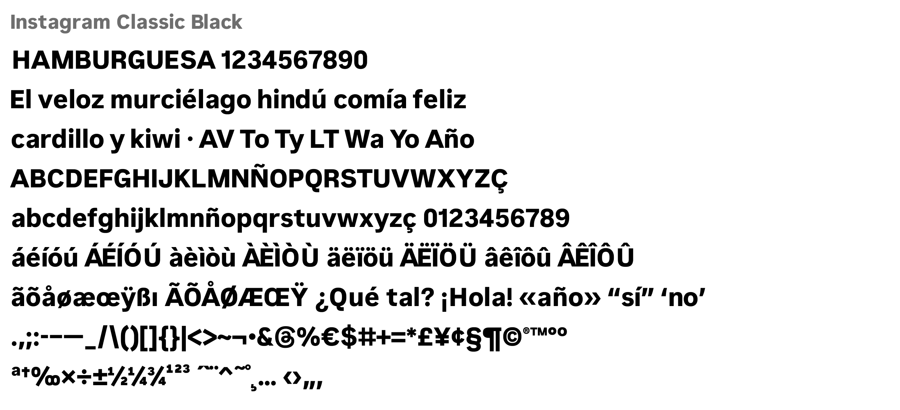

# Instagram Classic

Estilo de texto **Classic** de las historias de Instagram.

| | |
|---|---|
| Fuente | Instagram Classic Black |
| Tipo | Reconstruida desde capturas |
| Coincidencia con las capturas (IoU) | 0,983 (0,973–0,991) |
| Archivos | `InstagramClassic-Black.otf`, `InstagramClassic-Black.ttf`, `InstagramClassic-Black.woff2` |

## Origen

Classic pertenece a la familia IG UI (la tipografía de la interfaz de Instagram) en un peso más negro que Bold que no aparece en ninguna versión de la app. Se reconstruyó a partir de 50 capturas de iPhone, usando IG UI Bold como regla de alturas.

## Verificación

- Anchura de palabras completas: HAMBURGUESA +0,3 % · 1234567890 −0,3 % · ABCDEFGHIJKLM 0,0 %.
- La fuente disponible más parecida (IG UI Bold) da 0,841.
- Peso estimado en 900 por la progresión del grosor del trazo en IG UI.

## Notas

- 203 glifos: alfabeto latino ampliado, acentos compuestos, ç ñ ß æ œ ø å, puntuación, símbolos, fracciones y superíndices.

_La coincidencia se mide superponiendo el texto renderizado sobre la captura y calculando la intersección sobre unión (IoU) de la tinta, de 0 a 1. Una fuente idéntica da 0,94–0,98._

## Licencia

Reconstrucción a partir de capturas de una fuente propietaria de Meta. Uso personal y no comercial; no redistribuir.
