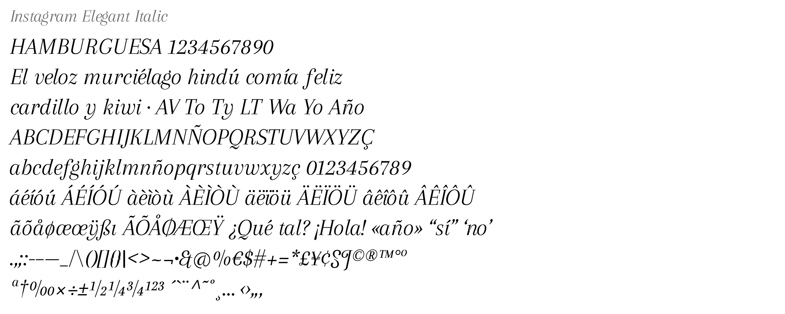

# Instagram Elegant

Estilo de texto **Elegant** de las historias de Instagram.

| | |
|---|---|
| Fuente | Instagram Elegant Italic |
| Tipo | Reconstruida desde capturas |
| Coincidencia con las capturas (IoU) | 0,919 |
| Archivos | `InstagramElegant-Italic.otf`, `InstagramElegant-Italic.ttf`, `InstagramElegant-Italic.woff2` |

## Origen

Ninguna de las versiones de la app revisadas (9 IPA de iOS y 3 APK de Android) contiene esta fuente; Instagram la descarga al usar el estilo y la guarda en almacenamiento privado. Se reconstruyó a partir de 49 capturas 1440×2560 generadas automáticamente vía ADB en Android: cada grupo de caracteres se escribió en el editor de historias y se guardó la imagen. Los glifos se aislaron, vectorizaron (potrace) y montaron con fontTools; el espaciado y el kerning se ajustaron midiendo líneas de texto reales.

## Verificación

- Anchura de líneas de texto: ±1,0 % (6 líneas).
- La cifra es algo menor porque los trazos finos miden 2–3 px en las capturas.

## Notas

- Serif cursiva, 11,9°. Probablemente es Instagram Serif Italic, que no aparece en ninguna versión revisada de la app.

_La coincidencia se mide superponiendo el texto renderizado sobre la captura y calculando la intersección sobre unión (IoU) de la tinta, de 0 a 1. Una fuente idéntica da 0,94–0,98._

## Licencia

Reconstrucción a partir de capturas de una fuente propietaria de Meta. Uso personal y no comercial; no redistribuir.
