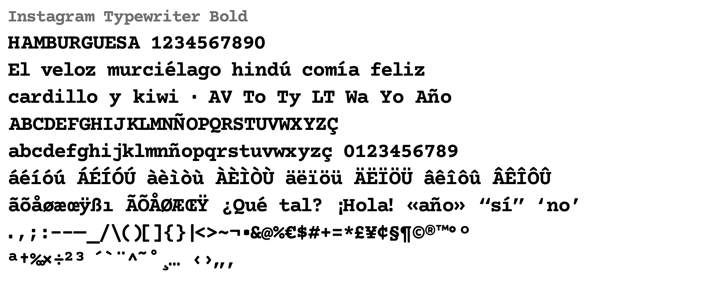

# Instagram Typewriter

Estilo de texto **Typewriter** de las historias de Instagram.

| | |
|---|---|
| Fuente | Instagram Typewriter Bold |
| Tipo | Reconstruida desde capturas |
| Coincidencia con las capturas (IoU) | 0,976 (mín. 0,951) |
| Archivos | `InstagramTypewriter-Bold.otf`, `InstagramTypewriter-Bold.ttf`, `InstagramTypewriter-Bold.woff2` |

## Origen

Ninguna de las versiones de la app revisadas (9 IPA de iOS y 3 APK de Android) contiene esta fuente; Instagram la descarga al usar el estilo y la guarda en almacenamiento privado. Se reconstruyó a partir de 49 capturas 1440×2560 generadas automáticamente vía ADB en Android: cada grupo de caracteres se escribió en el editor de historias y se guardó la imagen. Los glifos se aislaron, vectorizaron (potrace) y montaron con fontTools; el espaciado y el kerning se ajustaron midiendo líneas de texto reales.

## Verificación

- Ninguna fuente disponible coincide: Courier Bold 0,838 · Courier New Bold 0,761 · American Typewriter Bold 0,708. Es de la familia Courier, pero otra versión.
- Monoespaciada: las letras pegadas en las capturas se separaron por el paso fijo.

## Notas

- No incluye ± ½ ¼ ¾ ¹.

_La coincidencia se mide superponiendo el texto renderizado sobre la captura y calculando la intersección sobre unión (IoU) de la tinta, de 0 a 1. Una fuente idéntica da 0,94–0,98._

## Licencia

Reconstrucción a partir de capturas de una fuente propietaria de Meta. Uso personal y no comercial; no redistribuir.
